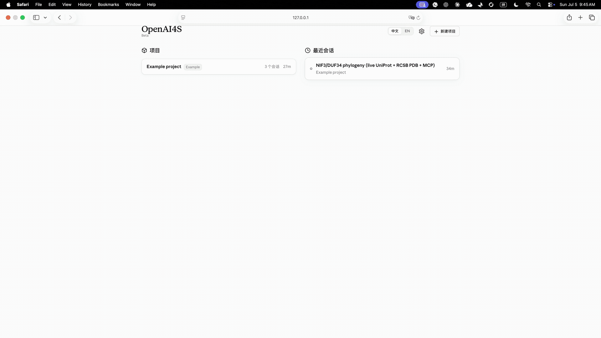
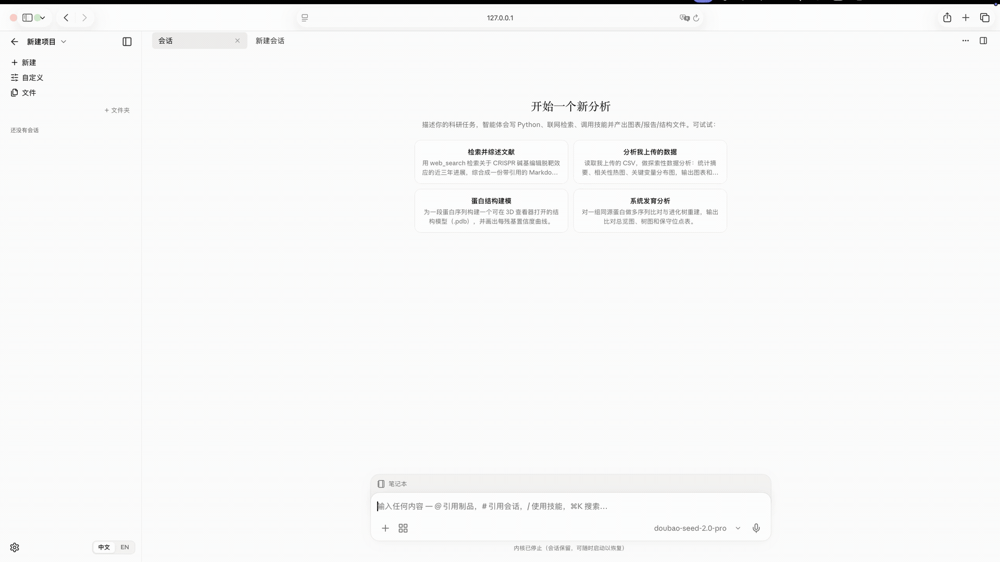
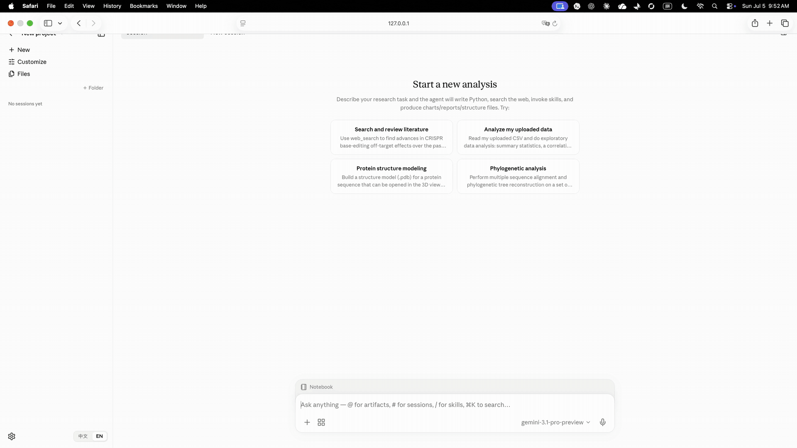
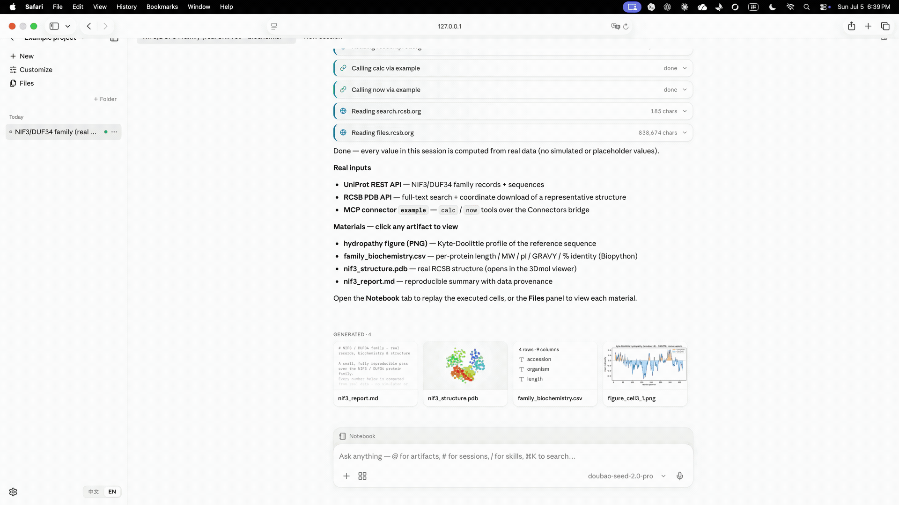
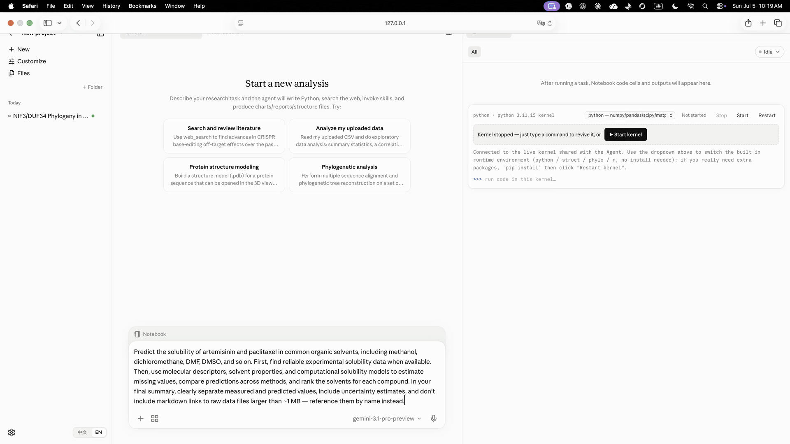
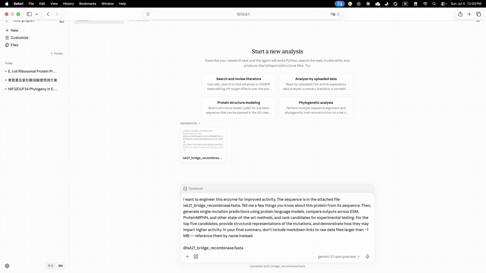

<div align="center">


### Open AI for Scientist

## 💸 Replicating Claude Science in two cuts or less

**An open-source hybrid scientific research agent.**<br/>
<sub>JSON tools orchestrate; persistent Python/R kernels do the science.</sub>

**Launched by the Peking University–YuanKong Intelligence AI Joint Research Laboratory.**<br/>
<sub>由北京大学—元空AI联合实验室推出。</sub>

<p>
  <a href="LICENSE"></a>
  
  
  
  
</p>
<p>
  <a href="https://github.com/PKU-YuanGroup/OpenAI4S/stargazers"></a>
  <a href="https://github.com/PKU-YuanGroup/OpenAI4S/network/members"></a>
  <a href="https://github.com/PKU-YuanGroup/OpenAI4S/issues"></a>
  <a href="https://github.com/PKU-YuanGroup/OpenAI4S/pulls"></a>
</p>

**English** · [简体中文](README_zh.md)

</div>

---

> [!TIP]
> **Why "two cuts"?** No pricey frontier-model key needed — OpenAI4S runs on **Doubao (豆包)** via the cheapest **"Small" plan on Volcengine Ark (火山方舟)**: **¥9.9 / month (≈ US$1.4)**. Pick the `ark` provider in the UI and you get a Claude-Science-class agent for less than a cup of coffee.

<div align="center">

<br/>
<sub>Volcengine Ark · Agent Plan (Personal) — the entry <b>Small</b> tier is <b>¥9.9 / month</b>.</sub>
</div>

---

## 🧬 JSON orchestration, Code-as-Action science

OpenAI4S deliberately has two action planes. Provider-native **JSON tool
calls** handle deterministic orchestration, permissions, metadata, external
services, and human approval. **Python/R Code-as-Action** handles computation,
exploration, analysis, simulation, and long-running scientific work in
persistent kernels. Python cells can synchronously call the in-kernel `host`
API while they run; R is an independent persistent analysis channel.

This is not a choice between tools and code: each does the job it is good at.
Tool-only and conversational work can finish through the Engine-owned,
strictly structured `finalize_response` action. Scientific cells keep the
important `host.submit_output(...)` completion contract, including structured
artifacts and metrics. `host.submit_output` is the only completion signal that
can fire *inside* a Cell; a later sole `finalize_response` may still close the
Engine after earlier Cells have run.

<table>
<tr><th></th><th>JSON control plane</th><th>Python/R science plane</th></tr>
<tr><td align="right"><b>Best for</b></td><td>workflow, permissions, metadata, services</td><td>computation, analysis, simulation</td></tr>
<tr><td align="right"><b>Action unit</b></td><td>One ordered native-tool batch</td><td><b>One complete code cell</b></td></tr>
<tr><td align="right"><b>Composition</b></td><td>auditable schemas and resource policy</td><td><code>for</code>, <code>if</code>, libraries; Python also has mid-cell Host RPC</td></tr>
<tr><td align="right"><b>State</b></td><td>append-only Action Ledger</td><td>kernel memory + versioned artifacts</td></tr>
<tr><td align="right"><b>Completion</b></td><td>Engine-owned <code>finalize_response</code></td><td>Python: <code>host.submit_output(...)</code>; R: no in-cell completion</td></tr>
<tr><td align="right"><b>Extending</b></td><td>named <code>Tool</code> subclass</td><td>import a library or load a Skill</td></tr>
<tr><td colspan="3">

```python
# ReAct: ~14 round-trips (read → … → filter → sort → plot).   OpenAI4S: one code cell.
hits   = [f for f in files if pattern in host.read_file(f)]
top3   = sorted(hits, key=os.path.getsize, reverse=True)[:3]
frames = [pd.read_csv(f) for f in top3]      # a 100k-row DataFrame stays in the kernel...
host.save_artifact(plot(frames))             # ...only "<DataFrame 100000×20>" hits context
```

</td></tr>
</table>

---

## 📣 News

- **`2026-11-12`** 🤖 **Agentic RL runtime** — OpenAI4S now doubles as an environment for reinforcement learning. An external trainer samples the policy; the agent executes with its real tools, permissions, and kernels; and the new `openai4s/rl` package records each rollout as a versioned Science Trajectory and exports deterministic JSON/JSONL training data plus the ATIF-v1.8 interchange format used by Harbor. Rewards, costs, admission, and budget stay in separate append-only records, and interrupted rollouts fail closed instead of being replayed. → [RL runtime](openai4s/rl/README.md)
- **`2026-11`** 🔭 **`main` — after `v1.0.0`** — optional anonymous **Parallel Search** as a keyless backup web-search engine (off by default; `openai4s init --search parallel`), and **endpoint model discovery** in First-run setup: **Fetch models from endpoint** lists the model ids an Ark/OpenAI-compatible, Responses, Anthropic, Gemini or Ollama endpoint actually serves, instead of guessing a default. → [Configuration](docs/configuration.md)
- **`2026-11-09`** 🔬 **[`v1.0.0`](https://github.com/PKU-YuanGroup/OpenAI4S/releases/tag/v1.0.0) — the OpenMHS lab** — a major update: OpenAI4S now ships [OpenMHS](https://mhs.openai4s.org) (the open-source Model Hardware Standard) as a git submodule. The new **Lab** tab beside the Notebook runs simulated instruments under endpoint-enforced limits, e-stops and hash-chained receipts, and installs any of **746 devices** from the [OpenMHS market](https://mhs.openai4s.org/market/) in one click or one command (`openai4s lab add <id>`), through native MHS tools or an MCP connector. The release also adds **Ollama** models and web tools, an optional **You.com** search, a molecular-dynamics Skill (**612 Skills**), and bounded read-only previews. The Apple Silicon **DMG** is back as an ad-hoc-signed image beside the Linux, Windows/WSL2, PyPI and GHCR channels. The database moves from schema 35 to 36; read **[Upgrading to 1.0.0](docs/upgrading.md)** before the first start. → [OpenMHS guide](docs/openmhs.md)
- **`2026-10-18`** 📁 **[`v0.3.1`](https://github.com/PKU-YuanGroup/OpenAI4S/releases/tag/v0.3.1) — local project folders and portable history** — link source folders, browse saved conversation history, import scientific datasets with checksum verification, and work with **611 bundled Skills**. Linux and Windows/WSL2 packages are on GitHub, Python packages on PyPI, and the public container image on GHCR. macOS uses PyPI while signing and notarization are deferred. The database moves from schema 32 to 35; read **[Upgrading to 0.3.1](docs/upgrading.md)** before the first start.
- **`2026-09`** 🧭 **`v0.3.0` — the new workbench, and the first Windows package** — the Preact/TypeScript workbench replaces the `app.js` monolith as the default UI, and the release adds the first **Windows/WSL2 zip** beside the Linux tarball. Every local daemon now requires its access token: the `OPENAI4S_REQUIRE_TOKEN=0` loopback opt-out is gone. Interactive HTML reports run on a separate sandboxed origin, Notebook cells keep the exact artifact versions they produced, long-context compaction actually lands and survives a restart, delegated sub-agents inherit their environment and leave durable, exportable cell records, and Auto Mode admits budget atomically and stops a run that makes no progress. The single-cell RNA analysis Skill brings the total to 604. The Apple Silicon **macOS image** is an ad-hoc-signed preview, not a notarized one. The database schema moves from 27 to 32, so read **[Upgrading from 0.2.x](docs/upgrading.md)** before the first start.
- **`2026-08-24`** 🚀 **`v0.2.0` — the multi-platform release** — one release, two desktop packages: the Apple Silicon **`.dmg`** and a relocatable **Linux `x86_64` tarball** carrying the same embedded Python and science stack (the Windows/WSL2 zip is built and under stabilization — it ships in a coming release). Underneath: **Auto Mode** with a Guardian review boundary, honest **completion-evidence reconciliation** (a crashed cell can no longer render as a clean success), the **MCP Streamable HTTP** transport with the Volcengine DataPro connector and Doubao web search, **Anthropic Messages SSE streaming**, the pinned **561-recipe bioSkills collection** (603 Skills in all, installable anywhere via `npx`), a trajectory-ledger view in the workbench, Docker/Kubernetes deployment, `openai4s --version`, and the interrupt-signal train that makes a running R cell reliably stoppable on every platform.
- **`2026-08-04`** 🔭 **`main` — on the way to `v0.2.0`** — **read-only session sharing** over an outbound relay tunnel (`openai4s share` / `openai4s relay`), **seven normalized public-database connectors** that carry where a record came from and when, a versioned **`/api/v1`** surface (keyset pagination, one error envelope, a resumable WebSocket cursor), **environments as a transaction** (`openai4s env plan|apply|rollback`), a redacted `doctor` / `diagnostics` support bundle, consent-gated revocable telemetry, a retrosynthesis-planning Skill, and a **10-workflow / 20-case benchmark** that runs against the real Store, kernels, and dispatcher. Linux and Windows desktop packages were built and tested here — the Linux package ships in `v0.2.0` above, and the Windows package follows in a coming release.
- **`2026-07-15`** 🍎 **`v0.1.0` — macOS app** — a one-click, no-toolchain Apple Silicon `.dmg` with an embedded Python and the full default kernel science stack (rdkit · scanpy · the single-cell stack), plus PyPI packaging (`pip install openai4s`) and release automation. **New here? → [Startup guide](docs/startup-guide.md).**
- **`2026-07-06`** 🎉 **Open-sourced** — the pure-stdlib Code-as-Action engine, the scientific web app, 24 science Skills, and BYOC remote compute.

---

## 😮 Highlights

- **🧬 Hybrid action engine** — class-based native JSON tools orchestrate while persistent Python/R kernels execute science. CLI and Web adapters start foreground language slots lazily, so tool/finalize routing itself does not spawn one; individual tools may still manage dedicated workers.
- **📒 Ledger-first runtime** — action groups/events and terminal facts are append-only; execution attempts, generation lifecycle, usage, and completion records remain durable and reconstructable.
- **🤖 Agentic RL runtime** — an external trainer can drive OpenAI4S as its environment: it samples the policy, the agent executes with real tools and kernels, and `openai4s/rl` records an append-only Science Trajectory. Exports are deterministic JSON/JSONL/ATIF with byte hashes; rewards and costs stay separate versioned records, so re-scoring never rewrites execution history, and interrupted rollouts are reported rather than replayed.
- **🐍 Pure-stdlib core** — the engine **and** the web server are stdlib-only (`http.server` + hand-rolled WebSocket, no framework, no deps). The LLM client speaks OpenAI / Anthropic / Gemini over `urllib` alone.
- **🔌 One-line multi-provider** — `ark` (doubao · glm · kimi · deepseek · minimax), official `chatgpt` · `openai_responses` · `claude` · `gemini`, and `ollama` (cloud or local), behind a single `host.llm`; switch from the UI.
- **🔬 OpenMHS simulated lab** — a Lab tab with 746 installable simulated devices from the OpenMHS market, reached through native MHS tools or an MCP connector, with endpoint-enforced limits, e-stops and hash-chained receipts. Installing, start/stop and e-stop stay human actions. → [OpenMHS guide](docs/openmhs.md)
- **🖥️ Scientific workbench** — live streaming, versioned artifacts, provenance, an Action Timeline surface, and a **read-only-by-default Notebook**. An explicit developer flag enables multiline Python/R input against the shared kernels.
- **🔐 Hardened local execution** — strict child-environment allowlists, durable approvals, one-shot generation-bound `host.bash` capabilities, and OS sandbox adapters (Seatbelt on macOS, bubblewrap on Linux) with visible degraded/fail-closed modes.
- **🔬 612 bundled Skills** — 51 curated OpenAI4S recipes for GPU/model science, research workflows, and platform operations, plus all 561 recipes from the pinned MIT-licensed GPTomics/bioSkills collection. Skills are **recipes of code**, not JSON schemas; the large third-party collection is searched on demand and occupies only one always-on prompt line. User-authored Skills stay under the data directory and cannot shadow bundled trust.
- **☁️ BYOC remote compute** — with a configured, reachable provider, dispatch GPU jobs via `ssh:<alias>` or the bundled **NVIDIA NIM** integration. General remote compute remains a Prototype surface; `host.fold` uses a strict no-fabrication policy.
- **🔗 Read-only session sharing** — publish a session as a snapshot anyone with the link can view and import, through a relay **you** run. The daemon never binds a public port; it dials out. Memories, permission state, and keys never leave, and residual secrets fail the publish closed. → [Web sharing](docs/webshare.md)
- **🔎 Source-attributed retrieval** — ten normalized public-database connectors (Zenodo · UniProt · RCSB PDB · Ensembl · ChEMBL · PubChem · arXiv · OpenAlex · STRING · BindingDB), plus three behind a feature flag (ClinVar · PubMed · ClinicalTrials.gov). Retrieved records carry where they came from and when, without the API key that fetched them.
- **🧰 Operable, not just runnable** — a versioned `/api/v1` (keyset pagination, one error envelope, correlation IDs, a resumable WebSocket cursor), a local credential required at startup, a redacted `doctor` / `diagnostics` support bundle, and consent-gated telemetry that is off by default and destroys its identity when revoked.

---

## 📦 What ships today

A capability map of the current tree — what is implemented and reachable, plane by plane.

| plane | what's implemented |
|---|---|
| **Control & orchestration** | class-based native `Tool`s · append-only Action Ledger · plan/review with a durable state machine · context compaction that archives the raw slices it summarizes · concurrent sub-agent delegation (fanout 48, depth 4) a user can stop mid-flight · enforced Specialist allowlists a child cannot widen · MCP connectors · cross-session memory |
| **Scientific execution** | persistent Python **and** R kernels · synchronous mid-cell `host` RPC · object-level data lineage · versioned artifacts · environment provenance recorded per kernel *generation*, never borrowed from the daemon · background execution · 612 Skills (51 curated + 561 pinned bioSkills) · a FIFO execution coordinator with ABA-safe watchdog recovery |
| **Data & retrieval** | ten normalized public-database connectors (Zenodo · UniProt · RCSB PDB · Ensembl · ChEMBL · PubChem · arXiv · OpenAlex · STRING · BindingDB) plus three flag-gated ones (ClinVar · PubMed · ClinicalTrials.gov), whose records carry source and time · a nightly canary over three of them · Agent-Plan-keyed **Doubao Search Custom** as the primary web search · reorderable backups: Tavily, You.com, built-in keyless engines, and opt-in anonymous Parallel · Ollama web search and fetch with their own key · managed DataPro professional-dataset search |
| **Lab** | the OpenMHS submodule found automatically · a Lab tab with MHS/MCP device groups, live state, e-stop latches and receipt charts · a device market of 746 simulated devices · `openai4s lab` (`setup`, `add`, `remove`, `search`, `show`, `list`, `status`, `up`, `down`, `reset`) · an auto-maintained **OpenMHS Lab** project |
| **Workbench** | live streaming · Action Timeline · read-only-by-default Notebook · branch fork/activate/revert · verified recovery with an explicit Partial/Failed state · `@file` references pinned to the version they name · 2D chemistry/genome/sequence/MSA/LaTeX renderers · Markdown and `.ipynb` export |
| **Agentic RL** | external trainers drive the real agent loop · append-only Science Trajectory records · deterministic JSON/JSONL/ATIF (Harbor ATIF-v1.8) exports with byte hashes · per-decision training samples with prompt token IDs and loss masks · verifier, cost, admission, and budget ledgers kept separate from execution facts |
| **Sharing & portability** | read-only session shares over an outbound relay you operate · quarantined portable Session packages · an optional Jupyter KernelSpec bridge onto the same kernels |
| **Ops, safety & release** | `/api/v1` and a startup credential · Seatbelt/bubblewrap sandbox adapters with visible degraded and fail-closed modes · durable approvals that deny by default when unattended · redacted diagnostics · revocable telemetry · environments as a transaction · a 13-workflow/46-case benchmark against the real Store, kernels, and dispatcher · a staged release pipeline that verifies artifacts before anything becomes public |

### Experimental features

A default-off **semantic judgment layer** (TypeSafe Jev) can add Skill
suggestions, literature claim checks, text-feature engineering, and
recording-only safety / task-mode shadows. It stays off until you enable it,
needs your own TypeSafe key, and sends text to a service hosted in the United
States. → [Experimental semantic judgment](docs/experimental-judgment.md)

---

## 🎬 Demo

<table>
<tr>
  <td width="50%"><b>Live API workflow</b> — from UniProt / RCSB to a 3D structure &amp; report<br/></td>
  <td width="50%"><b>Real-data analysis</b> — human insulin INS (P01308): from UniProt / RCSB to a reproducible report<br/></td>
</tr>
<tr>
  <td width="50%"><b>Visual artifact editing</b> — “raise the confidence cutoff to 75” in one line<br/></td>
  <td width="50%"><b>Annotation-driven chart editing</b> — lasso a region &amp; recolor the legend<br/></td>
</tr>
<tr>
  <td width="50%"><b>Plan-mode research</b> — artemisinin &amp; paclitaxel solubility prediction<br/></td>
  <td width="50%"><b>Protein engineering</b> — from sequence to ranked mutants &amp; structural rationale<br/></td>
</tr>
</table>

---

## ⚡ Quickstart

**Current release: [1.0.0](https://github.com/PKU-YuanGroup/OpenAI4S/releases/tag/v1.0.0).** Choose an installation channel below. If you already have data from 0.3.1 or earlier, stop the daemon and back up the whole data directory before installing: 1.0.0 migrates the database from schema 35 to 36, and going back is unsupported. See [Upgrading](docs/upgrading.md).

| Channel | 1.0.0 download |
| --- | --- |
| macOS Apple Silicon | [DMG](https://github.com/PKU-YuanGroup/OpenAI4S/releases/download/v1.0.0/OpenAI4S-1.0.0-macos-arm64.dmg) ([SHA-256](https://github.com/PKU-YuanGroup/OpenAI4S/releases/download/v1.0.0/OpenAI4S-1.0.0-macos-arm64.dmg.sha256)), ad-hoc signed, not notarized |
| Linux x86_64 | [Standalone tarball](https://github.com/PKU-YuanGroup/OpenAI4S/releases/download/v1.0.0/OpenAI4S-1.0.0-linux-x86_64.tar.gz) |
| Windows x86_64 with WSL2 | [Complete ZIP](https://github.com/PKU-YuanGroup/OpenAI4S/releases/download/v1.0.0/OpenAI4S-1.0.0-windows-x86_64.zip) |
| Python, including Intel Macs | [PyPI: openai4s 1.0.0](https://pypi.org/project/openai4s/1.0.0/) |
| Containers (linux/amd64) | [GHCR: openai4s](https://github.com/orgs/PKU-YuanGroup/packages/container/package/openai4s), tag `1.0.0` |
| Download verification | [SHA256SUMS](https://github.com/PKU-YuanGroup/OpenAI4S/releases/download/v1.0.0/SHA256SUMS) · [Build and validation evidence](https://github.com/PKU-YuanGroup/OpenAI4S/releases/download/v1.0.0/openai4s-1.0.0-evidence.zip) · [macOS validation record](https://github.com/PKU-YuanGroup/OpenAI4S/releases/download/v1.0.0/OpenAI4S-1.0.0-macos-arm64-validation.json) |

To run the released source (`--recursive` also fetches the OpenMHS lab submodule):

```bash
git clone --recursive --branch v1.0.0 https://github.com/PKU-YuanGroup/OpenAI4S && cd OpenAI4S
./setup.sh     # one-time: build the environment with uv
./start.sh     # launch the web UI at http://127.0.0.1:8760/
```

`setup.sh` creates the lightweight control `.venv` with **uv**. For the comprehensive Python + R scientific kernels, install a Conda-family manager (`micromamba`, `mamba`, or `conda`) and run `./setup.sh --with-kernel-envs` instead. Existing kernel environments can be synchronized with `./setup.sh --update-kernel-envs`; updates do not prune user-installed packages. `start.sh` launches the daemon + web UI. No API key is needed to boot — **set your model in the UI** (Customize → Models). One-shot without the UI: `uv run openai4s run "Compute the mean of [4,8,15,16,23,42] and submit it." -v`.

### macOS

> [!NOTE]
> **1.0.0 ships an ad-hoc-signed Apple Silicon DMG.** It has no Developer ID signature and no Apple notarization, so macOS blocks its first launch until you allow it. Intel Macs, and anyone who prefers a virtual environment, install [PyPI 1.0.0](https://pypi.org/project/openai4s/1.0.0/) instead.

**Apple Silicon app.** Download [OpenAI4S-1.0.0-macos-arm64.dmg](https://github.com/PKU-YuanGroup/OpenAI4S/releases/download/v1.0.0/OpenAI4S-1.0.0-macos-arm64.dmg) and its [SHA-256 file](https://github.com/PKU-YuanGroup/OpenAI4S/releases/download/v1.0.0/OpenAI4S-1.0.0-macos-arm64.dmg.sha256) into one folder and check it:

```bash
shasum -a 256 -c OpenAI4S-1.0.0-macos-arm64.dmg.sha256   # must print: OpenAI4S-1.0.0-macos-arm64.dmg: OK
```

Open the DMG, drag **OpenAI4S** into **Applications**, eject the disk image, and launch the app. If macOS blocks the first launch, open **System Settings → Privacy & Security** and choose **Open Anyway**. The app embeds Python 3.13 and the default science stack, starts the local daemon, and opens the workbench in your browser.

**PyPI (Apple Silicon and Intel).** Install into a virtual environment of its own, with Python 3.10 or newer:

```bash
python3 -m venv ~/.venvs/openai4s && source ~/.venvs/openai4s/bin/activate
python -m pip install --upgrade "openai4s[science]==1.0.0"   # use "openai4s[science,chemistry]==1.0.0" for RDKit
openai4s serve                    # starts the daemon and opens the workbench with its access token
```

Data lives in `~/.openai4s`. If you close the tab, `openai4s url` prints the authenticated workbench URL again. The R kernel needs a Conda-family manager (`micromamba`, `mamba` or `conda`); run `openai4s setup` once to build it.

**First run — point it at a model, then at search.** No key ships, so once the workbench is open:

1. **Model API** — the **First-run setup** wizard walks you through it, or open **Settings ⚙ → Models** later. Pick a protocol (**Ark-compatible** for Doubao/GLM/Kimi/DeepSeek/MiniMax, **OpenAI-compatible**, **OpenAI Responses**, **Anthropic-compatible**, **Gemini-compatible**, or **Ollama** for cloud or local models), paste your **API Key**, and save the profile as the active one. In the wizard, **Fetch models from endpoint** lists the model ids your endpoint actually serves. Cheapest path: the `ark` protocol on Volcengine Ark's ¥9.9/mo plan.
2. **Search API** *(optional, recommended)* — open **Settings ⚙ → Network**, keep **Allow network access** on, and paste your Ark **Agent Plan Key** into the primary **Doubao Search Custom** card → **Save credential**. If the active model is an Ark **Agent Plan**, you can skip this step: OpenAI4S saves that key as the default for both Doubao Search and DataPro professional datasets, and they keep working after you switch to another model. Tavily, You.com and the built-in keyless engines remain reorderable backups, and anonymous Parallel can be switched on; the dedicated Doubao health check never reports a fallback result as Doubao.

Full 1.0.0 walkthrough (install → model → search → R kernel): **[Startup guide](docs/startup-guide.md)**.

### Linux app (no toolchain required)

Download the [1.0.0 Linux tarball](https://github.com/PKU-YuanGroup/OpenAI4S/releases/download/v1.0.0/OpenAI4S-1.0.0-linux-x86_64.tar.gz) and [SHA256SUMS](https://github.com/PKU-YuanGroup/OpenAI4S/releases/download/v1.0.0/SHA256SUMS) into the same directory. Verify it, unpack it anywhere, and run it. It embeds its own Python and the pre-baked science stack, as a relocatable directory:

```bash
sha256sum --ignore-missing -c SHA256SUMS   # the Linux tarball must report OK
tar -xzf OpenAI4S-1.0.0-linux-x86_64.tar.gz
cd OpenAI4S-1.0.0-linux-x86_64
./OpenAI4S          # starts the daemon and opens http://127.0.0.1:8760/
./install.sh        # optional: `openai4s` on your PATH + an application-menu entry
```

`install.sh` is per-user and needs no root — it only writes into `$HOME`, and `./uninstall.sh` undoes it while leaving your data in `~/.openai4s` alone. Install `bubblewrap` (`apt install bubblewrap`) so cells run sandboxed; without it the default `OPENAI4S_KERNEL_SANDBOX=auto` reports a visibly degraded, unisolated kernel. Only `x86_64` is published — on arm64 Linux, use a virtual environment and the pinned PyPI command above.

### Windows (via WSL2)

Download the [complete 1.0.0 Windows ZIP](https://github.com/PKU-YuanGroup/OpenAI4S/releases/download/v1.0.0/OpenAI4S-1.0.0-windows-x86_64.zip) and [SHA256SUMS](https://github.com/PKU-YuanGroup/OpenAI4S/releases/download/v1.0.0/SHA256SUMS), verify the ZIP as described in the [Windows/WSL2 guide](docs/windows-wsl.md#english), then extract all files and double-click `OpenAI4S.cmd`. No split-file restoration is needed. The first run checks WSL2 and a working bubblewrap 0.8.0+ sandbox, verifies and installs the bundled Linux payload, creates `~/.local/bin/openai4s`, starts the daemon there, and opens an authenticated local URL in your Windows browser. No application download, no `pip`, no toolchain. Ubuntu 24.04 is the supported baseline; mainland PyPI/Conda mirrors and an optional WSL-reachable proxy can be configured by the launcher.

**1.0.0 validation:** the public x86_64 ZIP passed a post-publication runtime run on Windows Server 2025 with Ubuntu 24.04 WSL2: the shipped launcher, the authenticated dashboard in a Windows Chromium browser, nine science and runtime checks (plots, immutable artifacts and restart read-back among them), status/stop, and enforced bubblewrap isolation. That run used no model credentials, and the launcher is still unsigned. Windows on ARM and the full Windows 10/11 host matrix were not exercised.

`v0.3.0` is the first release that ships this package. Its acceptance evidence covers WSL2 on x86_64 with the tested Ubuntu 24.04 distribution. The last section of the [WSL2 parity audit](docs/windows-wsl-parity-audit.md) ("Fix verification — 2026-09-07") leaves the following unverified:

- A side-by-side macOS run for the parity comparison. The macOS side of that comparison was read from source, not run.
- Windows on ARM, other distributions, and WSL network modes other than the tested one.
- Real provider sign-in and inference. The scientist flow ran with `OPENAI4S_NOTEBOOK_REPL=1` and no live model.
- Conda environment provisioning, so R and other named environments on Windows are unverified. R was installed in the test distribution only as a test prerequisite.
- Every domain recipe.
- A Windows reboot. Only a restart of the WSL distribution was tested; it reopened the saved results and a stored credential.
- Cold-start performance. The unmodified full browser smoke did not pass: it exceeded its 20-second queue-admission wait. WSL service connection timeouts were also seen under concurrent load.

**Native Windows is not supported, and the program refuses to start a kernel there** rather than warning and proceeding — it spawns POSIX subprocesses, the R channel rides file descriptors 3 and 4 through a shell redirection, and the sandbox has no Windows backend. WSL2 reports as Linux, so this package runs the same build every other platform runs. If you do not have WSL2 yet, the launcher stops and tells you the exact command (`wsl --install`, from an Administrator PowerShell). Details: **[Supported platforms](docs/platforms.md)**.

### 🔬 OpenMHS lab: 746 simulated devices

```bash
git clone --recursive https://github.com/PKU-YuanGroup/OpenAI4S.git && cd OpenAI4S
./setup.sh && source .venv/bin/activate
openai4s lab add labs/tiagocoutinho__julabo   # any id from https://mhs.openai4s.org/market/
openai4s serve                               # Lab tab → Device market → Install
```

The `third_party/OpenMHS` submodule is found automatically (no `PYTHONPATH`). The PyPI and desktop packages do not bundle OpenMHS: run `openai4s lab setup` once, with Git and access to GitHub, to fetch the pinned release into `~/.openai4s/openmhs`. Devices run on simulators or fake backends;
hardware stays an explicit operator decision. Details: [OpenMHS guide](docs/openmhs.md).

### 🐳 Docker and Kubernetes

The [public GHCR package](https://github.com/orgs/PKU-YuanGroup/packages/container/package/openai4s) can be pulled without signing in. Pin `1.0.0` for this release; `latest` follows future releases. The image is **linux/amd64**; ARM hosts require amd64 emulation.

```bash
docker pull --platform linux/amd64 ghcr.io/pku-yuangroup/openai4s:1.0.0
docker run -d --name openai4s --platform linux/amd64 \
  -p 127.0.0.1:8760:8760 \
  -v openai4s-data:/data \
  -e OPENAI4S_SECRET_LLM_LLM_API_KEY="$OPENAI4S_LLM_API_KEY" \
  ghcr.io/pku-yuangroup/openai4s:1.0.0
docker exec openai4s openai4s url   # the URL, token included
```

The image contains Debian-slim CPython, the wheel, and the `science` extra, and runs as an unprivileged user with one volume at `/data`. The command forwards the model key from your shell's `OPENAI4S_LLM_API_KEY` to the container's `OPENAI4S_SECRET_LLM_LLM_API_KEY`; configure the provider and model as described in the [container guide](docs/docker.md). Credentials are read from the environment. To build from the checkout instead, use `docker compose up -d --build`. For Kubernetes, replace `image: openai4s:local` in `deploy/kubernetes.yaml` with `image: ghcr.io/pku-yuangroup/openai4s:1.0.0` before applying it to amd64 nodes; the guide covers the Secret, persistent volume, and access URL. The image bundles neither OpenMHS nor Git; to use the lab in a container, mount an OpenMHS checkout and point `OPENAI4S_OPENMHS` at it.

Release images pass `container_smoke.sh` before publication. Binding `0.0.0.0` inside the container makes the access token mandatory and switches the DNS-rebind `Host` allowlist off, so keep the published port on loopback. An unprivileged container cannot give bubblewrap the namespaces it needs, so the kernel sandbox degrades visibly and the container becomes the boundary; **[the container guide](docs/docker.md)** explains these limits.

### 🧩 Take the Skills anywhere (`npx`)

The 612 bundled Skills are recipes — prose, code, and the operational knowledge to run them — and nothing about them is OpenAI4S-specific. The latest npm release, **`@pku-yuangroup/openai4s-skills@0.3.0`**, contains **604 Skills: 43 curated + 561 pinned bioSkills**. Install that fixed release with:

```bash
npx @pku-yuangroup/openai4s-skills@0.3.0 install --all                  # v0.3.0: 43 curated Skills
npx @pku-yuangroup/openai4s-skills@0.3.0 install --collection bioskills # v0.3.0: 561 pinned bioinformatics recipes
npx @pku-yuangroup/openai4s-skills@0.3.0 install alphafold2 boltz --target claude
npx @pku-yuangroup/openai4s-skills@0.3.0 list
npx @pku-yuangroup/openai4s-skills@0.3.0 uninstall --all
```

`npx @pku-yuangroup/openai4s-skills <command>` selects the latest npm release. To use the current repository catalog instead (612 Skills: 51 curated + 561 bioSkills), run directly from GitHub; this form follows the default branch:

```bash
npx github:PKU-YuanGroup/OpenAI4S install --all                  # the 51 curated Skills
npx github:PKU-YuanGroup/OpenAI4S install --collection bioskills # the 561 pinned bioinformatics recipes
```

Both sources use the same target and overwrite rules. `--target claude` writes to `~/.claude/skills`, `--target openai4s` to `<data_dir>/user-skills`, and `--dir <path>` anywhere you name; the resolved absolute path is printed before anything is written there, and `--dry-run` stops at that plan. Every installed file's SHA-256 goes into a manifest beside the Skills, so a reinstall refuses to overwrite a Skill you have edited or one it did not install, and an uninstall removes only files it wrote. Every curated Skill page and the collection root under [`skills/`](skills/) carry an **Install** section with their own name already filled in, so you can install from whichever page you landed on.

If you already run OpenAI4S from this checkout, you already have all 612 — a bundled Skill takes precedence over a same-named one in your data directory. The command exists for the other direction.

---

## 📚 Documentation

The canonical bilingual documentation is published at **[openai4s.org/docs](https://openai4s.org/docs/)**. Its public source and issue tracker live in [Nobody-Zhang/openai4s-docs](https://github.com/Nobody-Zhang/openai4s-docs); the links below point to the code-adjacent copies kept with this repository.

| doc | what's inside |
|---|---|
| [**Startup guide**](docs/startup-guide.md) | macOS 1.0.0 walkthrough: the ad-hoc-signed Apple Silicon DMG or PyPI on Apple Silicon and Intel, model setup, and Doubao Search |
| [**Upgrading**](docs/upgrading.md) | Newest first. 1.0.0 (schema 35 → 36): back up first; dataset verification receipts, and the opt-in lab. 0.3.1 (schema 32 → 35): stop the daemon and copy the data directory before the first start, because going back is unsupported. From 0.2.x: back up the database before the 27 → 32 schema migration, why going back to 0.2.x is unsupported, and the access token that is now always required |
| [**OpenMHS lab**](docs/openmhs.md) | the simulated lab: setup, the device market, MHS and MCP surfaces, lab files, and operator actions |
| [**Architecture**](docs/architecture.md) | the hybrid action router, Action Ledger, `host` RPC, and lazy kernels |
| [**RL runtime**](openai4s/rl/README.md) | running OpenAI4S as an agentic-RL environment: the rollout lifecycle, JSONL trainer transport, trajectory exports, and training-data projection |
| [**Backend extension guide**](docs/backend-extension-guide.md) | where new Tool classes, host services, repositories, and session behaviour belong |
| [**Model backend bring-up**](docs/model-backend-bringup.md) | local/remote GPU selection, checkpoint staging, real-inference canary admission, and connector portability |
| [**Skills**](docs/skills.md) | 51 curated Skills + 561 pinned bioSkills + how to write your own |
| [**Skill development record**](docs/skill-development.md) | the empirical-analysis Skills developed here, their method choices, implementation and validation |
| [**Research experiments**](experiments/README.md) | Separate data and results for bounded DiD worked-example replications using the panel preprocessing Skill |
| [**Remote compute**](docs/compute.md) | BYOC GPU jobs, `host.fold`, auto-provisioning |
| [**Science connectors**](docs/science-connectors.md) | the ten default public databases and three flag-gated ones, their filters, and retrieval provenance |
| [**Web app**](docs/webapp.md) | UI features, Action Timeline, read-only Notebook, artifacts, and implementation status |
| [**Web sharing**](docs/webshare.md) | read-only session shares, the trust model, and running your own relay |
| [**Jupyter adapter**](docs/jupyter.md) | optional standalone Python/R KernelSpecs, install commands, and compatibility limits |
| [**Configuration**](docs/configuration.md) | model providers, env vars, conda envs, CLI |
| [**Docker / Kubernetes**](docs/docker.md) | the image, `compose.yaml`, the cluster manifests, and what a wildcard bind actually changes |
| [**Supported platforms**](docs/platforms.md) | the per-OS support tiers and why native Windows refuses to start a kernel |
| [**Windows / WSL2**](docs/windows-wsl.md) | Ubuntu 24.04 installation, sandbox checks, lifecycle commands, mainland mirrors, and localhost proxy behavior |
| [**Security**](docs/security.md) | defense-in-depth safety layers & remote-access notes |
| [**Experimental semantic judgment**](docs/experimental-judgment.md) | default-off TypeSafe Jev layer: how to enable and disable it, what each capability sends, kill switch, doctor/audit status |

---

## 🗺️ Roadmap

### Delivered

- [x] Ship the next-generation workbench foundation: branch activation and
  append-only Revert/Undo projections, verified recovery with explicit
  Partial/Failed state, dependency-level stale propagation, durable delegation,
  quarantined portable Session packages, checkpointed plan/review/memory state,
  and dedicated 2D chemistry/genome/sequence/MSA/LaTeX renderers. Arbitrary
  in-memory namespace objects are deliberately not serialized; recovery remains
  Partial unless a safe recipe can rebuild and verify them, and Fork is offered
  only on records that carry a proven checkpoint mapping, so older history
  returns 409.
- [x] Read-only session sharing over an outbound relay you operate, with the
  daemon never binding a public port and residual secrets failing the publish
  closed.
- [x] An **executable** benchmark of end-to-end scientific workflows — 13
  workflows / 46 cases run against the real Store, kernel managers, host
  dispatcher, and compute manager, where a declared `failure` /
  `permission_denied` / `recovered` / `provenance` outcome fails when the run
  *succeeds*. Publishing comparable public results is still ahead.
- [x] Environments as a transaction (`openai4s env plan|apply|rollback`): a
  generation is built fresh, verified, and only then pointed at atomically, so
  an artifact's provenance can name an immutable one.
- [x] A simulated instrument lab (`v1.0.0`): the OpenMHS submodule, a Lab tab,
  and a market of 746 devices that run on simulators or fake backends behind
  endpoint-enforced limits, e-stops and hash-chained receipts.
- [x] Keyless `web_search` beyond DuckDuckGo: You.com's free tier and opt-in
  anonymous Parallel Search sit beside the built-in engines as reorderable
  backups.

### Next

- [ ] **A notarized macOS image and arm64 packages.** The Linux package ships from `v0.2.0` and the Windows/WSL2 package from `v0.3.0`. The 1.0.0 Apple Silicon DMG is ad-hoc signed, not notarized, and only `x86_64` is published for Linux and Windows. A Developer ID-signed, notarized `.dmg` plus arm64 Linux and Windows-on-ARM packages would let every supported platform install without a toolchain.
- [ ] **NVIDIA scientific computing suites** — bring **BioNeMo** (biomolecular foundation models) and **Parabricks** (GPU-accelerated genomics pipelines) in as first-class Skills and BYOC backends, beyond today's NVIDIA NIM integration.
- [ ] Local GPU model serving so structure/design Skills run without remote compute.
- [ ] More BYOC providers (Modal / SLURM) beyond SSH + NVIDIA NIM.
- [ ] Stronger Linux isolation beyond bubblewrap where available (for example seccomp), and wider packaged sandbox smoke coverage.

---

## 💡 Contributing

OpenAI4S is a community effort to keep the **Code-as-Action** paradigm open.

Before opening a PR, please read [`.github/CONTRIBUTING.md`](.github/CONTRIBUTING.md) — it defines branch naming, the PR checklist ([`.github/pull_request_template.md`](.github/pull_request_template.md)), review & release policy, and the offline-test policy. Contributors can fork the repository and open PRs without write access. Nobody-Zhang reviews and decides when to merge; other reviewers are not automatically requested.

### Development setup

Contributor tooling requires **Python ≥ 3.11** and [**uv**](https://docs.astral.sh/uv/). The core and numeric science packages still support Python 3.10; matplotlib, RDKit, and pre-commit are installed only on Python 3.11+.

```bash
git clone https://github.com/PKU-YuanGroup/OpenAI4S && cd OpenAI4S
./setup.sh                          # uv sync --locked --extra science + pre-commit hook
./setup.sh --with-kernel-envs       # optional: full Python + R kernel stacks
uv run pytest                       # offline test suite (LLM mocked)
uv run pre-commit run --all-files   # format + lint everything
```

Style is enforced by **pre-commit** — `black`, `isort` (`--profile black`), and `ruff`, pinned in [`.pre-commit-config.yaml`](.pre-commit-config.yaml). Runtime deps: the core is **zero-dependency** (pure stdlib); the optional `science` extra pins `numpy>=1.24 · pandas>=2.0 · matplotlib>=3.7` (matplotlib on Python 3.11+, because current Pillow security releases require it).

### What we welcome

- **New Skills** — a `SKILL.md` (+ optional `kernel.py`) under `skills/` — recipes of code, not schemas.
- **New providers** — a wire adapter under [`openai4s/llm/providers/`](openai4s/llm/providers/) plus its provider definition and registry entry, or a BYOC compute provider.
- **Engine & UI** — the core is pure stdlib and readable; the workbench is Preact + TypeScript under [`frontend/`](frontend/), built into the committed `openai4s/server/webui/dist/`.

Keep the core dependency-free, guard optional science imports behind `try/except ImportError`, and make sure `uv run pytest` and `uv run pre-commit run --all-files` pass before opening a PR.

---

## 👍 Acknowledgement & related work

- **Claude Science** (Anthropic) — the closed reference architecture whose Code-as-Action design, persistent kernel, host-RPC protocol, and safety layers OpenAI4S independently reproduces in open source.
- **CodeAct** — *"Executable Code Actions Elicit Better LLM Agents"* — code as a unified action interface.
- **ReAct** — *"Synergizing Reasoning and Acting in Language Models"* — the `tool_use` baseline this project departs from.
- The science Skills stand on **ColabFold / AlphaFold, ESM, OpenFold, Boltz, Chai, ProteinMPNN, DiffDock, Evo2, Borzoi, scGPT, scVI-tools** and open data services (NCBI, UniProt, RCSB PDB, EBI, OpenAlex, Crossref).

---

## 🔒 License

Released under the **MIT License** — see [`LICENSE`](LICENSE).

---

## ✨ Star History

<a href="https://www.star-history.com/?repos=PKU-YuanGroup%2FOpenAI4S&type=date&legend=top-left">
 <picture>
   <source media="(prefers-color-scheme: dark)" srcset="https://api.star-history.com/chart?repos=PKU-YuanGroup/OpenAI4S&type=date&theme=dark&legend=top-left&sealed_token=s8MqiKCKQtHsKQ-3BcacqDuESDZqB_cdJtFhGm3vgR1iD_oTvZ4LKSqaYvbdn1M-HgWpPdZC5jjSY3VN09poKGhisKf1sIPJ9q--mhjVpEpOcLNBwIUz_w" />
   <source media="(prefers-color-scheme: light)" srcset="https://api.star-history.com/chart?repos=PKU-YuanGroup/OpenAI4S&type=date&legend=top-left&sealed_token=s8MqiKCKQtHsKQ-3BcacqDuESDZqB_cdJtFhGm3vgR1iD_oTvZ4LKSqaYvbdn1M-HgWpPdZC5jjSY3VN09poKGhisKf1sIPJ9q--mhjVpEpOcLNBwIUz_w" />
   
 </picture>
</a>

---

## ✏️ Citing

```bibtex
@misc{zhang2026openai4scodeactionscience,
      title={OpenAI4S: Code as Action, Science as Sessions},
      author={Gongbo Zhang and Hao Li and Yu Wang and Mujie Lin and Liuzhenghao Lv and Yicheng Mao and Yimi Wang and Jun Zhu and Minhan Tang and Zhengxiang Jiang and Yusong Wang and Jiayu Yao and Kunpeng Ning and Dawei Pang and Yonghong Tian and OpenAI4S Community and Yuyang Liu and Li Yuan},
      year={2026},
      eprint={2609.15096},
      archivePrefix={arXiv},
      primaryClass={cs.AI},
      url={https://arxiv.org/abs/2609.15096},
}
```

---

## 🤝 Community contributors

<!-- CONTRIBUTORS:START -->
<a href="https://github.com/Nobody-Zhang" title="Nobody-Zhang"></a>
<a href="https://github.com/wangyu-sd" title="wangyu-sd"></a>
<a href="https://github.com/dvd233" title="dvd233"></a>
<a href="https://github.com/HowardLi1984" title="HowardLi1984"></a>
<a href="https://github.com/Linmj-Judy" title="Linmj-Judy"></a>
<a href="https://github.com/cursoragent" title="cursoragent"></a>
<a href="https://github.com/YuyangSunshine" title="YuyangSunshine"></a>
<a href="https://github.com/Grace-xyx" title="Grace-xyx"></a>
<a href="https://github.com/difficulttopickaname" title="difficulttopickaname"></a>
<a href="https://github.com/Weifeng2Wu" title="Weifeng2Wu"></a>
<a href="https://github.com/Lyu6PosHao" title="Lyu6PosHao"></a>
<a href="https://github.com/JunkaiWang-TheoPhy" title="JunkaiWang-TheoPhy"></a>
<a href="https://github.com/CyrusAuyeung" title="CyrusAuyeung"></a>
<a href="https://github.com/Devin-jun" title="Devin-jun"></a>
<a href="https://github.com/WenyuLiang" title="WenyuLiang"></a>
<a href="https://github.com/muzimu217" title="muzimu217"></a>
<a href="https://github.com/ClarenceYC" title="ClarenceYC"></a>
<a href="https://github.com/brainsparker" title="brainsparker"></a>
<a href="https://github.com/ChampionZhong" title="ChampionZhong"></a>
<a href="https://github.com/yusowa0716" title="yusowa0716"></a>
<a href="https://github.com/riiiiiiin" title="riiiiiiin"></a>
<a href="https://github.com/jiangzx25" title="jiangzx25"></a>
<a href="https://github.com/stau-7001" title="stau-7001"></a>
<a href="https://github.com/EQSTLab" title="EQSTLab"></a>
<a href="https://github.com/Pandasama2025" title="Pandasama2025"></a>
<a href="https://github.com/georgeatparallel" title="georgeatparallel"></a>
<!-- CONTRIBUTORS:END -->

<sub>Auto-generated daily from the GitHub <a href="https://github.com/PKU-YuanGroup/OpenAI4S/graphs/contributors">contributors graph</a> and a maintained public-recognition list by <code>scripts/update_contributors.py</code>.</sub>

---

<div align="center">
<sub><b>OpenAI4S</b> · code is the action, the kernel is the environment. · <a href="README_zh.md">简体中文 </a> · Friend Link https://linux.do </sub>
</div>
